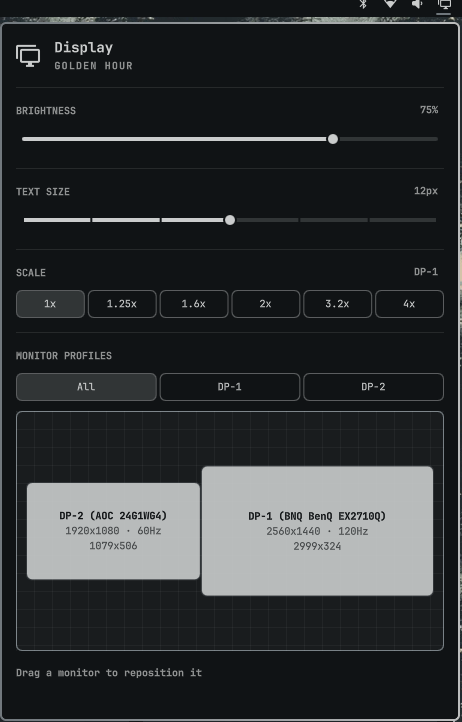

# Display & profiles

A bar widget for the Omarchy shell that adds a **monitor profile switcher** to the display panel. Selecting a profile rewrites the managed block in `~/.config/hypr/monitors.lua`, enabling/disabling the chosen monitors, and reloads Hyprland.



## Requirements

- The Omarchy shell with the built-in bar (Quickshell).
- Hyprland.
- `jq`.

## Install (copy & paste)

```bash
# 1. Add the plugin from git (enables it automatically)
omarchy plugin add https://github.com/AaronSR-54/omarchy-monitor-profiles --enable --yes

# 2. Place it in the bar
omarchy bar move aaronsr.monitor --section right

# 3. Reload the shell so the widget appears
omarchy restart shell

# 4. Nothing else — the profiles are generated automatically from the monitors
#    you have connected (one per monitor, plus "All").
```

That's it — the bar now shows the display widget. Open it by left-clicking the monitor icon. The profile switcher lists one entry per connected monitor, labelled with the panel's physical name (e.g. `BenQ EX2710Q`, `AOC 24G1WG4`) plus `All`, Windows-style: pick "only this monitor" or "both". Hover a pill to see its output name.

You never have to create or edit anything by hand: the profiles are internal, generated automatically from the connected monitors, and your manual arrangement (positions, scales) is preserved when they regenerate.

Profiles follow the **physical monitor** (make, model and serial reported by Hyprland), not just its output name. If `DP-1` and `DP-2` swap after a reboot or you recable the displays, your saved positions and scales stay with the right panel. Profiles written by older versions are still honoured through their output name.

Virtual outputs created with `hyprctl output create headless` (`HEADLESS-N`) are ignored: they get no profile, are left out of **All**, and don't affect which profile is marked active.

## Uninstall

```bash
omarchy plugin remove aaronsr.monitor --yes
omarchy restart shell
```

This removes the widget from the bar and deletes the plugin code. It leaves `~/.config/hypr/monitors.lua` as-is except for the managed block the plugin owns, and leaves `~/.config/omarchy/monitor-profiles/` in place in case you want to keep your arrangements.

## Features

- **Brightness, warmth, text-size, and scale controls** — inherited from the `omarchy.monitor` panel. The **warmth** slider maps 0–100% to a hyprsunset color temperature (6500K → 2700K) so you can warm up the screen from the same panel.
- **Per-monitor scale** — the scale slider (and `SUPER+/` / `SUPER+ALT+/`) changes the scale of the focused monitor only, and persists it in every profile plus `monitors.lua`.
- **Horizontal profile switcher** — one pill per connected monitor plus `All` (generated automatically, Windows-style), labelled with the monitor's physical name; click to apply.
- **Physical monitor identity** — saved positions and scales are keyed by make/model/serial, so they survive output renames (`DP-1` ↔ `DP-2`) and recabling.
- **Graphical layout preview** — the applied profile is drawn as an interactive canvas on a subtle grid. Each monitor is a rectangle at its relative logical size and position, labelled with its output, physical name, resolution, refresh rate and position. With several monitors active you can **drag them to reposition**:
  - **Magnet snapping** — on drop, the monitor glues to the nearest one along the side you released it (keeping your offset on the other axis, no forced centering) and never overlaps another.
  - **Explicit save** — dragging only updates the draft. Press **SAVE** to write the positions and apply, or **DISCARD** to revert.
  - The dragged monitor stays above the others while you move it.
- **Keyboard navigation** — j/k move between sections, h/l walk the profiles, Enter applies, Esc closes.

## Optional keybindings

```lua
-- ~/.config/hypr/bindings.lua

-- Open the profile selector focused on the active profile; each press
-- advances the selection, Enter applies.
o.bind("SUPER + SHIFT + P", "Monitor profiles", "omarchy-shell omarchy.monitor step")

-- Per-monitor scaling on the focused monitor.
hl.unbind("SUPER + SLASH")
o.bind("SUPER + SLASH", "Monitor scaling up", "bash -c '\"$HOME/.config/omarchy/plugins/aaronsr.monitor/set-scale.sh\" up'")
hl.unbind("SUPER + ALT + SLASH")
o.bind("SUPER + ALT + SLASH", "Monitor scaling down", "bash -c '\"$HOME/.config/omarchy/plugins/aaronsr.monitor/set-scale.sh\" down'")
```

## License

MIT. Derived from the `omarchy.monitor` panel (MIT, © Omarchy).